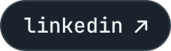
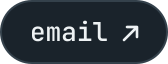
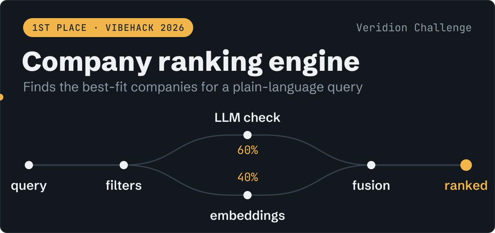
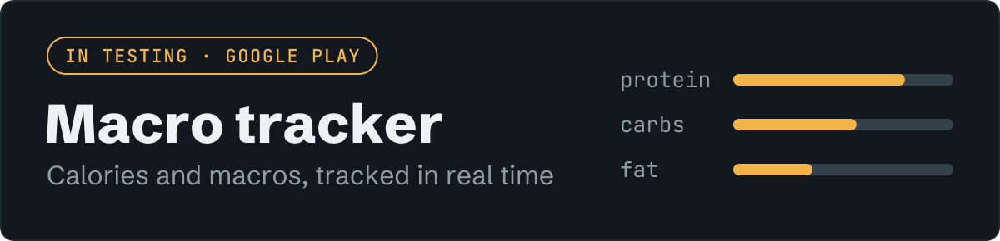
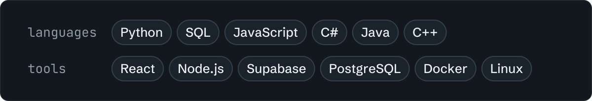

<a href="https://x3raz0r.github.io">
  <picture>
    <source media="(prefers-color-scheme: dark)" srcset="assets/hero-dark.svg">
    <source media="(prefers-color-scheme: light)" srcset="assets/hero-light.svg">
    
  </picture>
</a>

  <a href="https://x3raz0r.github.io"><picture><source media="(prefers-color-scheme: dark)" srcset="assets/btn-site-dark.svg"><source media="(prefers-color-scheme: light)" srcset="assets/btn-site-light.svg"></picture></a>
  <a href="https://x3raz0r.github.io/cv.pdf"><picture><source media="(prefers-color-scheme: dark)" srcset="assets/btn-cv-dark.svg"><source media="(prefers-color-scheme: light)" srcset="assets/btn-cv-light.svg"></picture></a>
  <a href="https://www.linkedin.com/in/antonio-andrei-medeleanu-023a5432b"><picture><source media="(prefers-color-scheme: dark)" srcset="assets/btn-linkedin-dark.svg"><source media="(prefers-color-scheme: light)" srcset="assets/btn-linkedin-light.svg"></picture></a>
  <a href="mailto:antoniozzr123@gmail.com"><picture><source media="(prefers-color-scheme: dark)" srcset="assets/btn-email-dark.svg"><source media="(prefers-color-scheme: light)" srcset="assets/btn-email-light.svg"></picture></a>

Economic Informatics student at ASE Bucharest, looking for a **software engineering internship**. I build data pipelines in Python and SQL, and full-stack apps in React and Supabase. Two hackathon wins in 2026.

## Selected work

<picture>
  <source media="(prefers-color-scheme: dark)" srcset="assets/pandora-dark.svg">
  <source media="(prefers-color-scheme: light)" srcset="assets/pandora-light.svg">
  
</picture>

**Pandora** won SmartHack 2026 (R Systems challenge, November 2026). It finds the devices on a home network and the open ports each one exposes, explains every risk in plain Romanian and English, and proves each fix with a re-scan. I co-owned the scanner and rules engine: findings and scores come from fixed rules, never from an AI, and match the organisers' validation set exactly (24 of 24 findings, 8 of 8 scores).

<samp>Python · FastAPI · nmap · React · TypeScript · Azure · ESP32</samp>

 

<a href="https://github.com/X3Raz0R/Verid">
  <picture>
    <source media="(prefers-color-scheme: dark)" srcset="assets/ranking-dark.svg">
    <source media="(prefers-color-scheme: light)" srcset="assets/ranking-light.svg">
    
  </picture>
</a>

**[Company ranking engine](https://github.com/X3Raz0R/Verid)** took first place in the Veridion Challenge at VibeHack 2026. It matches complex natural-language queries against a company database and ranks the best fits by industry, business model and location. Structured filters shrink the search space first, so the expensive LLM calls only run on companies that could actually match.

<samp>Python · embeddings · LLM</samp>

 

<picture>
  <source media="(prefers-color-scheme: dark)" srcset="assets/macro-dark.svg">
  <source media="(prefers-color-scheme: light)" srcset="assets/macro-light.svg">
  
</picture>

**Macro tracker** is a calorie and macro tracking app in React and Supabase, with personal dashboards that update in real time and food data from external nutrition APIs. Currently in testing on Google Play.

<samp>React · Supabase · PostgreSQL</samp>

## Experience

**Frontend developer**, Sindicatul Studenților din Cibernetică (SISC) 
Nov 2025 to now 
Reusable React components for internal projects, planned end to end with a small team.

**Data automation practicum**, Procter & Gamble Academic Program 
Mar to Apr 2026 
Python and SQL scripts that clean and aggregate operational datasets and cut manual reporting time.

## Stack

<picture>
  <source media="(prefers-color-scheme: dark)" srcset="assets/stack-dark.svg">
  <source media="(prefers-color-scheme: light)" srcset="assets/stack-light.svg">
  
</picture>

Algorithm practice lives in [neetcode-submissions](https://github.com/X3Raz0R/neetcode-submissions).
